# AI Yoga Posture & Wellness Companion

One webcam corrects your asana **live, while you hold it** — a real-time trainer,
not a photo classifier. It tracks 33 body landmarks, compares every joint against
a reference fitted from a public dataset, speaks the single most useful
correction, times the hold, and keeps a private practice log.

Final-year project, Department of Computer Engineering, K.C. College of
Engineering and Management Studies and Research, Thane.

**Ten asanas**: Vrikshasana (Tree, hand-tuned), Tadasana, Trikonasana, Virabhadrasana II,
Utkatasana, Adho Mukha Svanasana, Bhujangasana, Marjaryasana-Bitilasana, Balasana and
Sukhasana (fitted from public photographs). Every pose has a guided walk-in; Tree has the
longest.

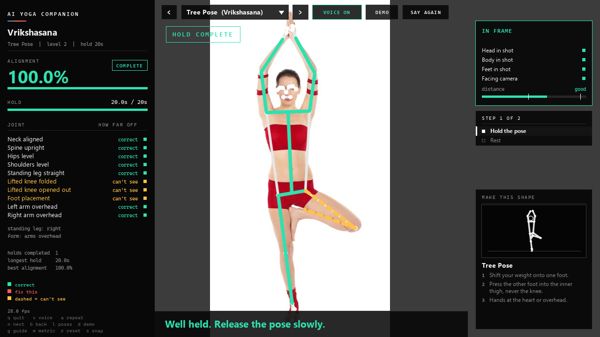

*The camera view in the project's black theme (a reference photograph run through the same pipeline the webcam feeds). Green = correct, red = fix this, dashed amber = cannot see.*

```
webcam ──▶ BlazePose (33 landmarks) ──▶ joint angles ──▶ compare with the
reference asana ──▶ alignment score + hold timer ──▶ spoken correction
                                                  └──▶ SQLite practice log
```

**No video is ever written to disk.** Frames are used and discarded; only derived
numbers are stored, on your own machine.

---

## Quick start

**Any laptop, one command.** Clone it and run:

```bash
python bootstrap.py --run
```

That one command is the whole thing: it builds the environment if it is
missing, repairs it if it is broken, downloads the pose model, runs the engine
self-test, and then starts the trainer. It is safe to run every time - on a
machine that is already set up it goes straight to the camera.

`bootstrap.py` is a self-healing installer: every requirement is a *check* paired
with a *repair*, run in a loop until the environment is green. It finds a Python
that MediaPipe actually has wheels for, builds the virtualenv, installs the
dependencies, downloads the pose model (retrying, and verifying it is not
truncated), and runs the engine self-test. It is safe to re-run at any time —
that is also how you diagnose a broken install:

```bash
python bootstrap.py --check  # diagnose only, change nothing
```

<details>
<summary>Other commands (each repairs the environment first)</summary>

```bash
python bootstrap.py --test        # 359 engine checks, no camera needed
python bootstrap.py --run         # live trainer
python bootstrap.py --calibrate   # learn your own tolerances
python bootstrap.py --demo        # scripted 90s practice through the real pipeline
python bootstrap.py --report      # practice history
python bootstrap.py --dataset     # fetch the dataset used for the reference
python bootstrap.py --fit         # re-derive the reference angles
python bootstrap.py --validate    # held-out validation against 4 other asanas
```

With `make`: `make setup | test | run | doctor | demo | dataset | docker`.
On Windows without `make`: `setup.bat`, `run.bat`, `test.bat`.
</details>

### Docker

No Python at all? Every number in the docs is reproducible from a container:

```bash
docker compose run --rm verify    # 359 engine checks
docker compose run --rm session   # scripted practice + progress report
docker compose run --rm dataset   # refit the reference, rerun the validation
```

The image bakes in the pose model and **runs the self-test during the build**, so
a green image means a green engine.

The live trainer needs a webcam and a window. On Linux the container can have
both (`xhost +local:docker && docker compose run --rm live`). On Windows and
macOS Docker cannot reach a webcam — run the trainer natively there, which
`python bootstrap.py --run` sets up in one command.

**Requires** Python 3.9–3.12 for a native install (MediaPipe publishes no wheels
for 3.13+) — or just Docker.

To quit: press `q` or `Esc` with the video window focused, or just close the
window. Other keys: `v` voice · `g` guide panels · `r` reset · `s` snapshot.

---

## Run it on another laptop (one click)

Windows 10/11 with a webcam and internet for the first run.

1. Get the project - either of these:
   * **Small download (about 25 MB, recommended):** the `AI-Yoga-Companion-portable.zip` on the
     [Releases page](https://github.com/Vishnu-patil26/ai-yoga-posture-companion/releases/latest).
   * **Whole repository (about 215 MB, includes the training photographs):** *Code > Download ZIP*,
     or `git clone https://github.com/Vishnu-patil26/ai-yoga-posture-companion.git`.
2. Unzip, then **double-click `START_HERE.bat`**.

The first run finds Python 3.9-3.12 - or installs Python 3.11 for the current user, no
administrator needed - builds a private environment, installs the libraries, fetches the pose
model if it is not already there, runs the engine self-test and opens the app. It takes about
5-10 minutes. Every later run opens the app in a few seconds. It never touches other Python
projects on the laptop. Safe to re-run: if something fails (no internet, a blocked download) it
says why and carries on from where it stopped next time.

`START_HERE.bat setup-only` installs and verifies without opening the app;
`START_HERE.bat trainer` opens the camera trainer directly. If the camera is blocked:
*Settings > Privacy & security > Camera > Let desktop apps access your camera*.
The portable zip is rebuilt with `python tools/package_portable.py`; it leaves out
`data/datasets` and `data/landmarks`, which are only needed to refit the poses.

---

## The launcher: profile, routine, plan, practice

```bash
python bootstrap.py --ui      # or launch.bat
```

1. **Profile** - diet plan, age, weight, height, bust/shoulder, waist, hip,
   diabetic, blood pressure, medication or conditions (free text, read by `yoga/nlp.py`),
   standing or sitting job, location. Stored on this machine only (`data/users/`);
   the first save issues a short ID (`YC-7F3A9C`). Mistakes are explained on the
   screen, with the offending field outlined, never in a pop-up.
2. **Routine** - pick by *lifestyle* (desk/sitting, standing workers, homemakers,
   students, lumbar care), by *goal* (daily energy, back pain, stress relief) or
   by *body position* (standing, sitting, lying/floor). The one matching your job
   is pre-selected. Or **ask the coach** in your own words ("my lower back hurts and
   I only have 10 minutes") and it picks a routine and says why
   (`yoga/nlp.py`). The **pose library** shows every pose with its photo, credit and
   category (tick poses in the order you want), and a **hierarchy** tab shows body
   position > category > pose > body points.
3. **Plan** - the routine after your profile is applied: holds shortened for age,
   BP, diabetes or BMI, head-below-heart poses skipped for high BP / 60+, cautions
   and diet notes. The rules only ever make a routine gentler.
4. **Practice** - pose by pose, all ten with the live camera trainer. Each pose has its
   own on-screen card (photo + three steps), a step-by-step spoken walk-in that waits
   for your body to reach each step, direction-aware corrections ("Sit lower", "Step
   your feet wider apart") and a hold timer. Tree keeps its longer 12-stage guided
   practice and neck-alignment tone. If a pose's fitted reference is ever missing, the
   launcher falls back to a voice-guided timer and says so.

   Honest limits (details and numbers in `docs/reports/VALIDATION.md`): poses are recognised
   well, but the score does **not yet reliably judge form quality**, Cobra's reference
   is permissive, and Child's pose is the hardest for a single camera. Only Tree is
   hand-tuned; the rest are fitted from photographs plus per-pose structure in
   `yoga/posespecs.py`. Rebuild with `python tools/fitting/build_library.py`, then
   `tools/fitting/calibrate_thresholds.py`, `tools/evaluation/library_eval.py`, `tools/evaluation/external_check.py`,
   `tools/evaluation/pose_check.py` (every pose end to end, no camera).

Checks: `python bootstrap.py --flow` (257 offline checks for routines, profile
rules, the launcher screens, the drawing helpers, the HUD layout, the demo clips and
the camera-window controls). `python bootstrap.py --clicks` is the click-through test: it
presses every button, tab, switch and drop-down on every launcher screen, Settings included
(436 checks), and
fails if any of them raises or lands on the wrong screen.

**Moving around.** Every screen except the first has a **Home** button at the top right
(also in the sidebar, and on the app name) that goes back to the profile screen. **Back**
names the screen it returns to (*Profile*, *Routines*, *Plan*, *Pose library*) and returns to
the screen you came from: the pose library goes back to wherever you opened it, and a plan
built from library ticks goes back to the library with the ticks kept. Pressing Home, a sidebar
button or a step name half-way through a routine shows the session summary first, so
the results so far are never lost; press Home again to leave.

### Choosing a pose, the voice, and the demo video

* **In the launcher**: tick poses in the library and press *Practise this pose now* on any
  card, or press **Camera: choose a pose** in the sidebar to open the camera at once and pick
  the pose there. *Skip - practise as a guest* on the profile screen needs no form and saves
  nothing. On the get-ready screen a **Pose** box swaps the pose, **Play audio / Stop audio**
  speak or silence the instructions on demand, and the card shows the **demo video** (or the
  photograph - two tabs). The sidebar **Voice: ON/OFF** button is one switch for the whole app
  and cuts speech mid-sentence.
* **The practice sequence** (`yoga/flow.py`; the nine fitted poses, Tree keeps its own coach): stand straight,
  turn sideways (or face the camera for a front-view pose), get into the pose slowly in 4 to 5 spoken steps that each
  wait for your body, hold for 10 seconds, an angle check of your arms, legs, spine and neck (spoken and shown on
  screen), then release, stand straight and take three slow breaths. The hold timer cannot start before the steps are
  done, and spoken corrections come only during the hold. When it ends, `n` goes to the next pose and `r` repeats this one.
* **How to do each pose** (`yoga/instructions.py`): every pose has a camera set-up line, 6 to 8 numbered steps,
  breathing and time, four common mistakes with their fixes, how to come out and a care note. The launcher's
  get-ready screen shows all of it and **Play audio** reads it. In the camera window each pose has 4 to 5 guided
  steps (short labels on the card, a full sentence spoken and shown as the caption), and the demo captions follow
  what the figure is doing (Mountain's arms sweep overhead and back down).
* **In the camera window** (buttons across the top, or keys): `n` / `b` next / previous pose,
  `l` the pose list (or `1`-`9`, `0` to jump), `d` a large demo over the picture, `v` voice
  on/off (off silences at once, on works even if the session started silent), `a` say the last
  instruction again. The window is resizable and the picture scales to it.
* **The demo video** (`yoga/demo.py`) is a looping stick figure drawn from *real* pose data: for
  each pose the joints of a real photograph (the textbook gallery photo where the pooled
  datasets were poor, otherwise the typical photograph of that pose in `data/landmarks`,
  rebuilt with `python tools/fitting/build_demo.py` into `data/demo_poses.json`). It moves
  from a plain starting position (standing, all fours, face down, kneeling) into the pose,
  holds it breathing, and returns - with every bone at its real length. Mountain and Easy
  pose start where they end, so they only breathe; Cat-Cow moves between its two real shapes.
  The starting positions are generic illustration, and a single stick figure cannot show a
  spine's curve, so Cat-Cow shows the head and pelvis moving rather than the arch.

### Optional: coach notes written by a language model (Groq)

The app works fully without this. With a free Groq key, two pieces of text are reworded by
`openai/gpt-oss-20b`: the explanation under **Ask the coach** and the **coach's note** on the
session summary. Nothing else changes: the routine is still chosen by `yoga/nlp.py`, poses are
still scored from joint angles, and the plain template text is shown first and stays if the model
is slow, offline, rate-limited or rejected.

* **Set up in the app** (about a minute, free, no card): open **Settings** in the sidebar, press
  **Get a free key** (opens <https://console.groq.com/keys>), create a key, copy it, then press
  **Paste** and **Save and connect**. The app writes the key to `.env` next to `launcher.py`
  (git-ignored, never uploaded), tests the connection and switches the wording on. **Test
  connection** checks a key before you save it, **Use online wording** switches it on or off without
  losing the key, and **Remove key** deletes it. The Routine screen has a shortcut when it is off.
  Editing `.env` by hand (see `.env.example`) or setting a Windows environment variable
  `GROQ_API_KEY` also works; the variable takes priority over the file. There is no local model to
  install.
* **What the model may say** is limited by `yoga/llm.py`. It gets facts the code already decided
  and a reply is dropped if it names a pose outside the routine, quotes a number that is not in the
  facts, mentions a dose, tells the user to stop a medicine, promises a cure, claims a routine
  treats a condition, or names a head-below-heart or belly-down pose that the user's profile rules
  out.
* **What leaves the computer**: the sentence typed into the coach box (e-mail addresses, phone
  numbers and links removed) or the pose names and numbers of a finished session, without the
  user's name. Never video, frames, landmarks, the user ID or the medication field. Switch it off in
  Settings (or set `YOGA_LLM=off`) to keep everything on the machine.
* **Limits**: Groq's free plan allows about 30 requests a minute and 1,000 a day for this model
  (check <https://console.groq.com/docs/rate-limits>); a rate-limited call just falls back to the
  template. Free-tier terms can change.
* **Check**: `python tests/test_llm.py` (88 offline checks with a fake model, including the settings
  functions and the connection test); add `--live` to make
  two real calls.

### The look

One black theme runs through every screen: near-black page, hairline borders,
square corners, monospaced capitals for labels, white as the only accent, and a
thin blue-orange-pink rule under each title (the same tokens as the Smart Customer
Segmentation app). The tokens live in `yoga/theme.py`; `yoga/ui.py` is the Tk
toolkit (sharp on scaled displays, dark title bar, no pop-up dialogs) used by
`launcher.py` and `collect.py`; `yoga/draw.py` draws real TrueType text on the
camera view. Regenerate every picture below with `python tools/session/ui_screenshots.py`.

| | |
|---|---|
| 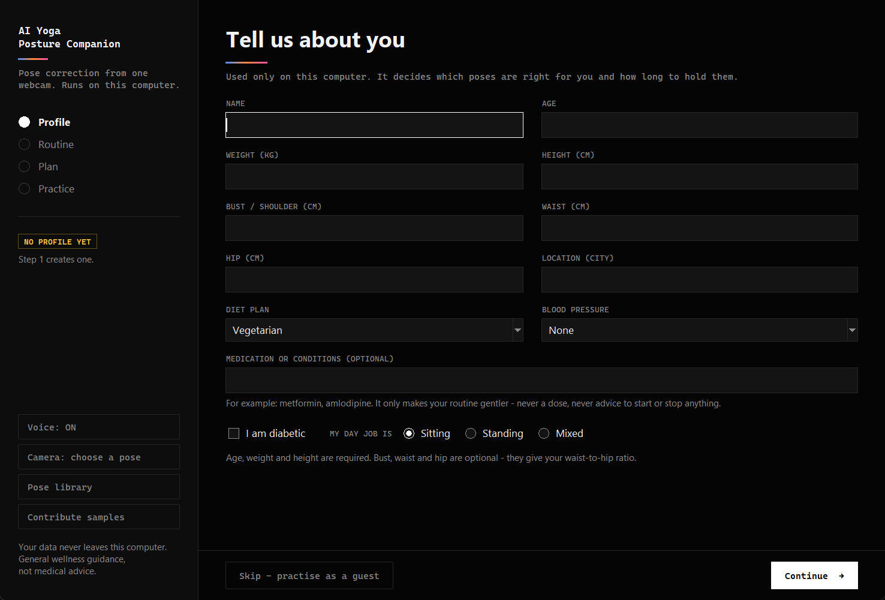 | 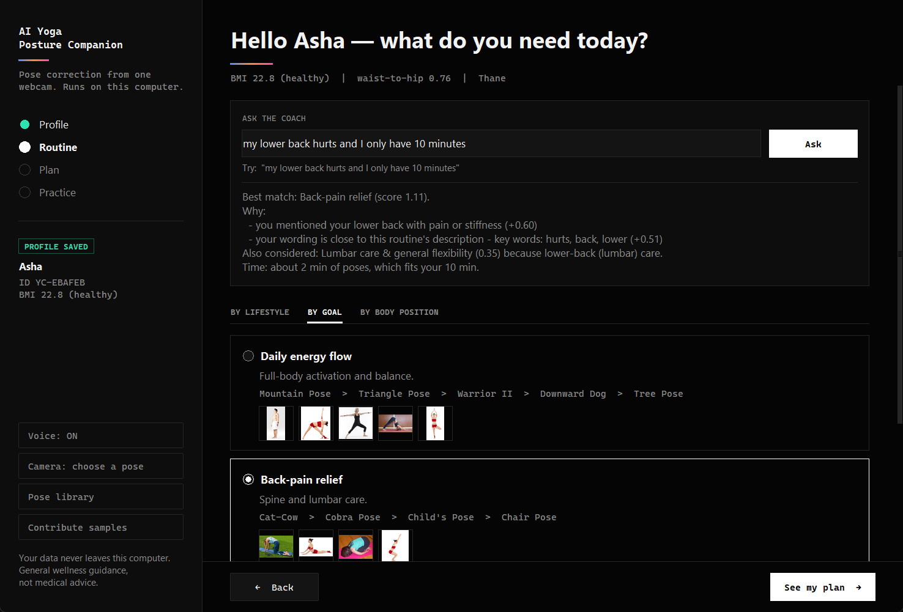 |
| 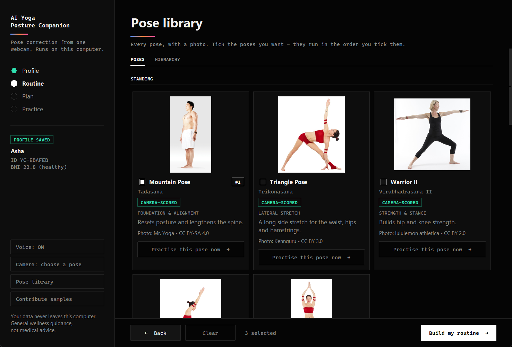 | 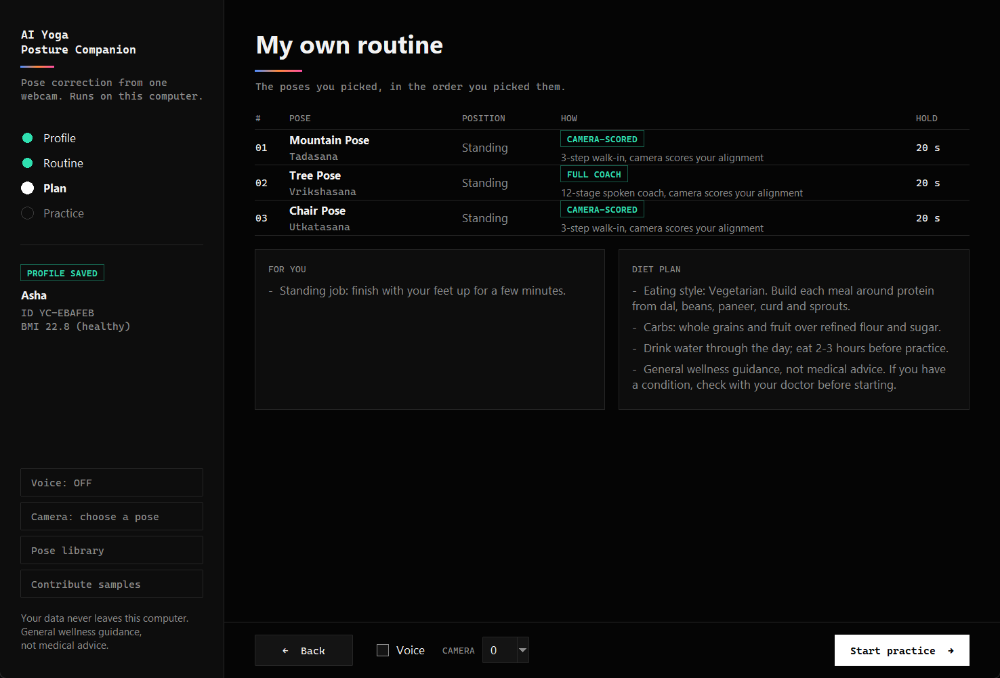 |
| 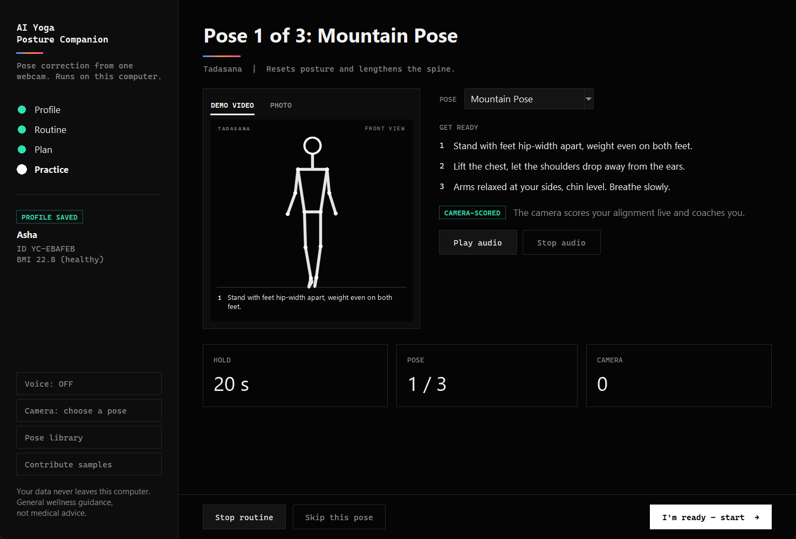 | 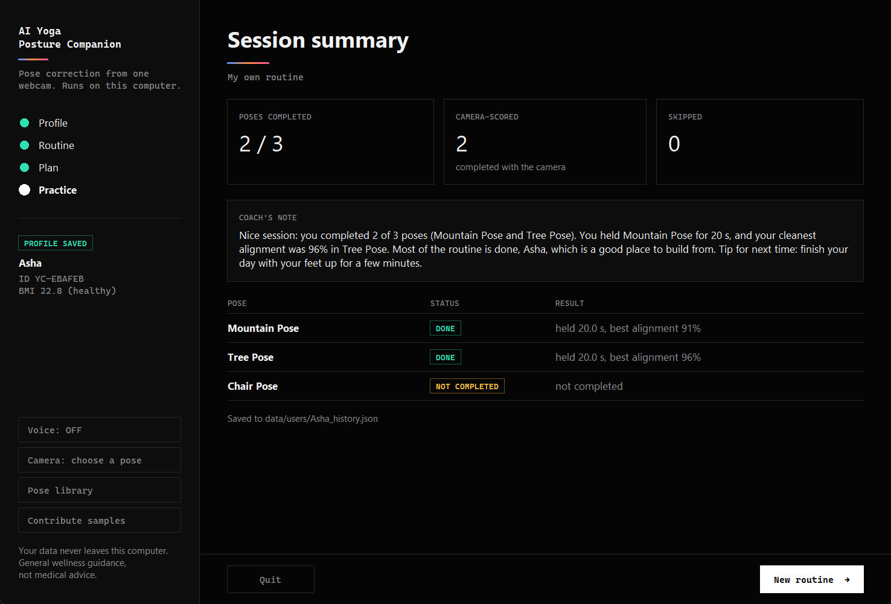 |

---

## What it does

**It talks you through the whole practice**, one stage at a time. Every stage
waits for your body to actually reach the position *and hold it* before moving
on — the settle and the count are simply long waits, so nothing can be raced
past:

| | stage | waits for |
|---|---|---|
| 1–4 | get in frame → stand tall → shift your weight → foot to the thigh | each position, held |
| 5 | **find your balance** | the pose, held **6 s** |
| 6 | **hands up** | both arms overhead |
| 7 | **close your eyes** | balance kept, **3 s** |
| 8 | **count to ten** | balance kept, **10 s** |
| 9–11 | **hands down → hands up → hands down** | the arms actually arriving |
| 12 | **rest** | a counted recovery, then the practice repeats |

Already in position? A stage whose condition is already met passes straight
through, so nobody sits through instructions they do not need.

| | |
|---|---|
| 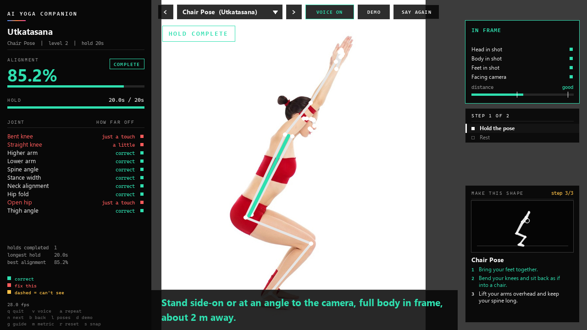 | 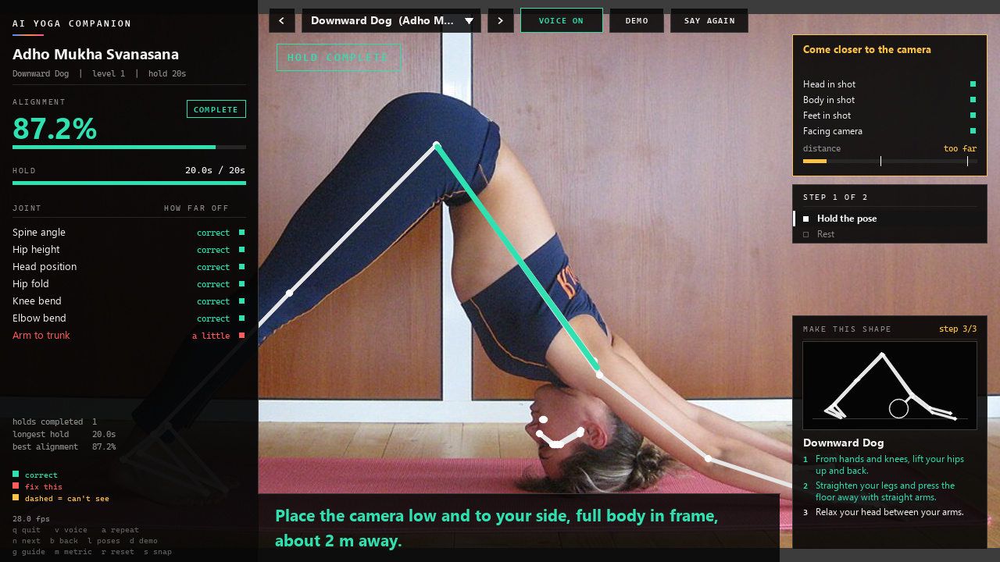 |
| The **IN FRAME** panel shows whether the camera can see your head, body and feet, how far away you are, and the one thing to fix next. The joint table names each fault in words. | Poses other than Tree show the **animated demo and three steps** on their card; the step list on the right slides so it never covers the card. The toolbar across the top picks the pose, switches the voice and opens the demo. |
| 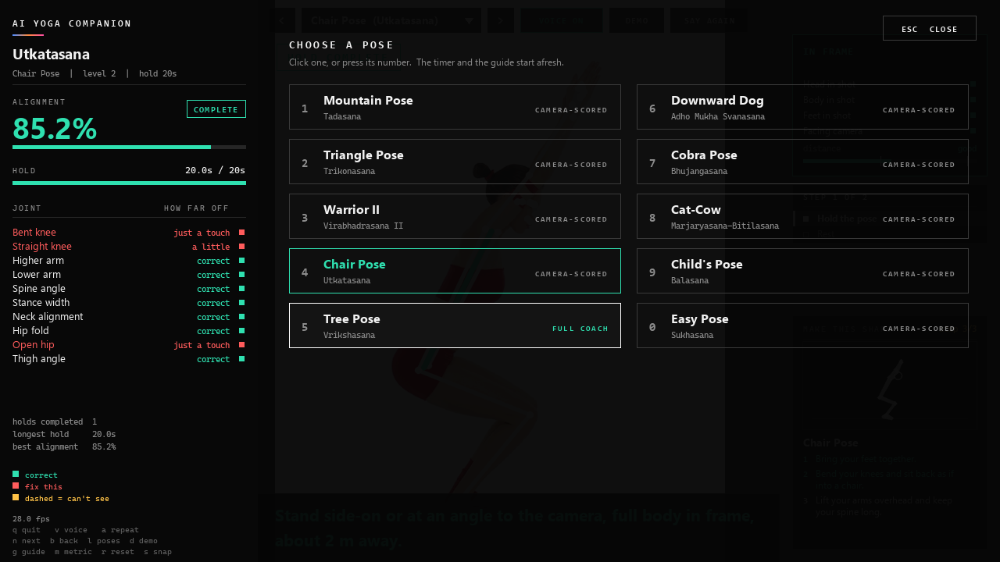 | 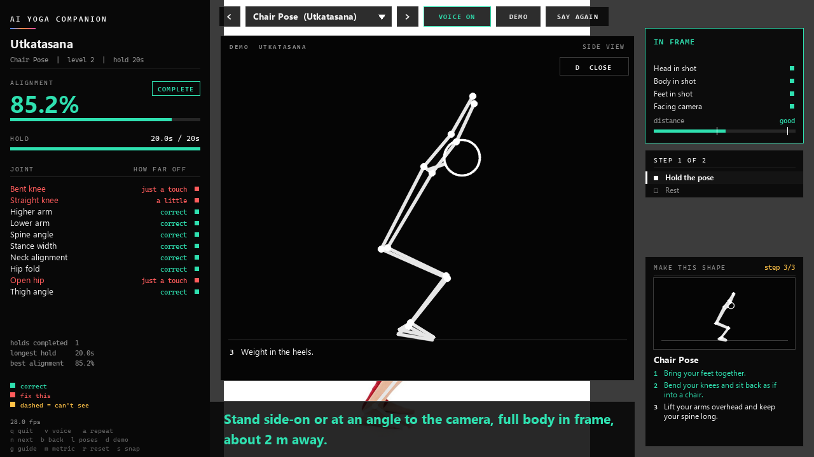 |
| `l` (or the pose name) opens the list of all ten poses; click one or press its number. | `d` opens the demo large, with the step it is showing. |

**One correction at a time.** A fault must persist a second before it is spoken,
each cue has its own cooldown, and a repeated fault escalates from a soft reminder
to a firm one. Somebody balancing with their eyes closed can act on one
instruction, not four.

**It knows there is more than one right answer.** Vrikshasana is taught with the
hands overhead *or* pressed at the heart. Both are scored and the better match
wins, so you are corrected towards the form you are actually attempting.

---

## The reference angles are fitted, not guessed

There is **no standard published table of ideal joint angles per asana** — the
papers that do angle-based correction each derive their own from data, and mostly
never print the numbers. So this project derives them and writes them down.

Fitted from 195 tree-pose images of the public TensorFlow/Moroney yoga dataset:
target = median, tolerance = 1.5 × robust σ. Reproduce with
`python bootstrap.py --fit`.

Three things the data overturned:

- **The hips are not level.** Fitted median 10° off horizontal even head-on — the
  pelvis genuinely hikes over the standing leg. A target of 0°, the obvious
  guess, would have corrected every correct practitioner.
- **The lifted ankle is half-occluded by definition** (median visibility 0.50) —
  it is pressed into the standing thigh. A strict visibility gate was refusing
  the pose *for being the pose*, discarding 174 of 200 correct images.
- **The arms are bimodal**, and every subject appeared in both clusters — two
  accepted forms, not two kinds of practitioner. The elbow checks a first pass
  included were deleted: they cut across the forms and do not discriminate.

**Held-out validation** — reference fitted on the train split, then every image of
the untouched test split of five asanas scored against Vrikshasana:

| class | n | mean score | ≥ 78 % threshold |
|---|---|---|---|
| **tree** | 95 | **90.1 %** | **94 %** |
| chair | 84 | 29.8 % | 0 % |
| cobra | 84 | 27.6 % | 0 % |
| dog | 39 | 32.4 % | 0 % |
| warrior | 83 | 29.8 % | 0 % |

**precision 1.000 · recall 0.937 · F1 0.967 · AUC 1.000** — 89 of 95 tree images
accepted, **0 of 290** images of other asanas. Reproduce with
`python bootstrap.py --validate`.

### The whole library, on held-out data

Every test image scored against *every* asana; the winner should be the right
one. Fitted on `train/`, scored on `test/`, which fitting never saw:

| true pose | n | recognised correctly |
|---|---|---|
| Utkatasana (chair) | 84 | **100 %** |
| Adho Mukha (dog) | 90 | **100 %** |
| Vrikshasana (tree) | 96 | **100 %** |
| Bhujangasana (cobra) | 116 | 82 % |
| Virabhadrasana (warrior) | 95 | 81 % |
| **overall** | **481** | **92 %** |

Reproduce with `tools/fitting/fit_asana.py` then `tools/evaluation/confusion.py`. The two weaker
rows are honest: that dataset's "warrior" class mixes Warrior I, II and III,
which are different shapes sharing one label.

Run a different asana with `--asana virabhadrasana` (or `utkatasana`,
`adho_mukha`, `bhujangasana`). Only Vrikshasana has the guided practice — the
step-by-step script talks about pressing a foot into an inner thigh, so the
others run in scoring mode and say so rather than reading out instructions
that do not apply.

Method, citations and the limitations of that sample:
**[docs/design/REFERENCES.md](docs/design/REFERENCES.md)**.

---

## Verified without a camera

`python bootstrap.py --test` runs **359 checks**, all offline:

* **Geometry** — skeletons built with a known spine lean, hip tilt, thigh opening
  and foot height measure back to within 0.6° and 0.02.
* **Fault attribution** — six deliberately wrong poses each name the correct
  primary fault.
* **Scoring** — one badly wrong joint denies the hold even when every other joint
  is perfect (the score is weakest-link, not an average).
* **Hold timer** — a 0.7 s wobble does not end a hold; a 2 s loss does.
* **Cue rules** — silent for the first second, cooldown respected, escalation soft
  → firm, and a correct pose is never nagged.
* **Visibility** — a half-occluded lifted foot is still graded; an invisible leg
  ungrades only its own checks; a hidden torso says "step back".

Plus `--demo`, which drives a scripted 90-second practice — sloppy start,
correction, full hold, failed attempt, clean hold — through the real evaluator,
state machine, cue engine and logger, and asserts that two holds complete.

**Measured performance** (1000×667, CPU only, Intel i7-13xxx): 13.9 ms landmark
inference + 0.13 ms scoring per frame; 28 fps end to end including the overlay.

---

## Datasets

All four datasets are in the repository under `data/datasets/` (details, licences and attribution in
[data/datasets/README.md](data/datasets/README.md) and [docs/policy/CREDITS.md](docs/policy/CREDITS.md)).
Only the raw 1.1 GB download of the 107-pose collection and volunteer photos are left out. The fitted
result is `data/asana_fits.json`; the per-photo landmarks and angles are in
[data/landmarks/](data/landmarks/README.md).

| Dataset | Used for | Folder | Licence |
|---|---|---|---|
| TensorFlow / Moroney 5-class set | Tree hand-tuning; Chair, Down Dog, Cobra fits and their test split | `data/datasets/yoga_poses/` | Apache-2.0 |
| 107-pose set, Hugging Face `rotemvahava/yoga-poses-107` (697 of its 5,994 photos) | Tadasana, Trikonasana, Warrior II, Balasana, Sukhasana, Cat-Cow; extra Chair, Down Dog, Cobra | `data/datasets/yoga107/` | not stated by the host; web photographs, included for research and education, removal on request |
| *Yoga for all* (Zenodo 7818789) - photos labelled right or wrong | External right-vs-wrong check, angle-deviation study (never fitted on) | `data/datasets/yoga_for_all/` | CC BY 4.0 |
| Wikimedia Commons (Trikoṇāsana) | Extra Trikonasana photos | `data/datasets/commons/` | per-file CC |

Not used: Yoga-82 and the other Kaggle sets named in `dataset.pdf` (they need an account or a request
form). The recipe saying which photos fit which pose is `tools/fitting/build_library.py`; method and
limits are in [docs/design/REFERENCES.md](docs/design/REFERENCES.md) and
[docs/reports/VALIDATION.md](docs/reports/VALIDATION.md). Re-download scripts are in
`tools/datasets/`. Volunteer photos from `collect.py` go to `data/collected/` (git-ignored; see
[docs/policy/COLLECTION_PROTOCOL.md](docs/policy/COLLECTION_PROTOCOL.md)).

---

## Layout

```
app.py             live camera trainer          launcher.py   the UI: profile -> routine -> plan -> practice
collect.py         volunteer photo collection   bootstrap.py  self-healing setup, doctor and task runner
run.bat  launch.bat  setup.bat  test.bat        Windows shortcuts for the above

yoga/              the engine (one package)
  vision             landmarks.py  filters.py  angles.py
  scoring            evaluator.py  state_machine.py  calibration.py
  poses              asanas.py (library + fitted refs)  posespecs.py (per-pose structure, cues, steps)
                     routines.py (poses, routines)  taxonomy.py (hierarchy + body points)  reference.py
  coaching           coach.py (Tree walk-in)  guide.py (step guide, every other pose)
                     feedback.py (cues + voice)  phrasing.py  nlp.py ("Ask the coach")
  people             profile.py (health profile)  collection.py (volunteer data)  storage.py (practice log)
  display            theme.py (colours, fonts)  draw.py (text on camera frames)  overlay.py (camera view + controls)
                     ui.py (Tk toolkit for launcher.py and collect.py)  demo.py (looping pose demos)

tools/             run once / occasionally, grouped by purpose
  datasets/        get_dataset  get_yoga107  get_yoga_for_all  get_commons_poses
                   export_landmarks (-> data/landmarks)  validate_landmarks
  fitting/         build_library (refit all poses)  calibrate_thresholds  fit_asana  fit_reference
                   build_demo (the real shapes behind the demo videos -> data/demo_poses.json)
  evaluation/      library_eval  external_check  pose_check  deviation_study  confusion
                   validate_dataset  make_validation (regenerates docs/reports/VALIDATION.md)
  session/         analyse  simulate_session  demo_frames  report  ui_screenshots (regenerates docs/images)
tests/             selftest  test_flow  test_clickthrough  test_nlp  test_collection  test_landmark_export  test_llm   (offline, no camera)

data/              asana_fits.json (the fitted library)   demo_poses.json (shapes for the demo videos)
                   results/ (evaluation outputs)
                   landmarks/ (landmark + angle CSVs and skeletons per pose, see its README)
                   datasets/ users/ collected/ (git-ignored)   samples/ demo/
assets/gallery/    the ten pose photos + credits.json
docs/              design/ (architecture, implementation, references)
                   reports/ (VALIDATION, ANGLE_DEVIATION - generated)
                   policy/ (COLLECTION_PROTOCOL, CREDITS)   images/
```

---

## Status

All ten poses run on the live camera trainer with a step-by-step guide. Tree is hand-tuned
and has the longest guided practice; the other nine are fitted from photographs with
per-pose structure in `yoga/posespecs.py`. The launcher covers profile, routines, the photo
gallery with custom routines, the personalised plan and practice.

Known limits (numbers in [docs/reports/VALIDATION.md](docs/reports/VALIDATION.md)): poses are
recognised well but form quality is not yet validated; Cobra is permissive; Child's pose is the
weakest for one camera.

The launcher also has the "Ask the coach" box, the user ID, the medication field, the pose
hierarchy and a button that opens the volunteer-collection window. Next: hand-tune the
remaining poses with volunteer data, test every pose on a real webcam, desk-posture mode, rPPG
vitals, packaging.

---

## Boundaries

Wellness and education, **not a medical device**. The alignment score is a
geometric agreement measure against a fitted reference, not a clinical or
certified assessment, and it does not replace a teacher. The camera window is
visible the whole time and no frame is saved unless you press `s`. Video never leaves the
computer; only if a Groq key is set, short text for the coach notes does (see above).

## Licence

MIT — see [LICENSE](LICENSE). Third-party attribution in [NOTICE](NOTICE):
MediaPipe (Apache-2.0) and the TensorFlow yoga-pose dataset (Apache-2.0).
